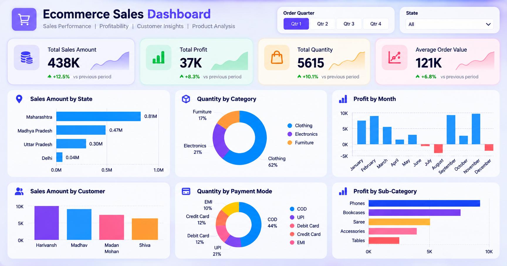

# E-Commerce Sales & Profit Intelligence Dashboard

**Power BI | Business Intelligence | Sales Analytics | Data Visualization**

An interactive Power BI report exploring e-commerce sales, profitability, order quantities, customer and regional sales patterns, and payment-method distribution. Developed by **Shahwaiz Ahmad** during the **Data Analyst internship at Excellence Delivered (ExD), June–August 2026**.

> **Project status:** Power BI report included. Genuine dashboard screenshots and documented findings will be added after reviewing the report in Power BI Desktop. No revenue values or performance-improvement percentages are claimed without source verification.

## Project overview

This project presents sales transaction information in a concise, single-page business intelligence dashboard. It brings together key performance indicators, time-based profit trends, product performance, customer/state comparisons, and interactive filters to support exploration of the sales data.

### Questions the dashboard helps explore

- How do recorded sales amounts, profit, order quantities, and average-order-value figures compare?
- How does profit vary by month and product sub-category?
- Which product categories and payment methods account for different shares of order quantities?
- How do sales amounts vary across states and customers?
- How do the visuals change when filtering by order quarter or state?

## Dashboard features (verified from the `.pbix` report layout)

| Component | What the report displays |
|---|---|
| KPI cards | Sales amount, profit, quantity, and AOV field |
| Monthly analysis | Profit by month of order date |
| Product analysis | Profit by sub-category; quantity by category |
| Payment analysis | Quantity by payment mode |
| Geographic analysis | Sales amount by state |
| Customer analysis | Sales amount by customer |
| Interactive slicers | Order quarter and state |

The report layout references tables named **`Orders`** and **`Details`**. It uses fields such as order date, customer name, state, amount, profit, quantity, product category, sub-category, payment mode, and AOV. The exact dataset origin, data-refresh process, and AOV calculation have not been independently verified.

## Technologies

- **Microsoft Power BI Desktop** — report authoring and visualization
- **Power BI data model** — report tables and related fields

Other tools or processes (for example SQL, DAX measures, or Power Query transformations) will be documented only after their use in this specific project is confirmed.

## Dashboard preview



## Repository structure

```text
Ecommerce-Sales-Profit-Intelligence/
├── README.md
├── dashboard/
│   └── Ecommerce_Sales_Profit_Intelligence.pbix
├── images/
│   └── .gitkeep
└── docs/
    └── SCREENSHOT_GUIDE.md
```

## How to open the report

1. Download `dashboard/Ecommerce_Sales_Profit_Intelligence.pbix` from this repository.
2. Open the file with **Microsoft Power BI Desktop**.
3. Explore the KPI cards, charts, and the **Quarter** and **State** slicers.
4. Review the connected data and any refresh requirements before modifying the report.

## Analysis and results

The report supports analysis of sales, profitability, order quantity, and category/customer/state-level breakdowns. Specific numerical findings will be added only after confirming them in the actual dashboard; they are intentionally not invented here.

## Project context

Prepared as part of the author's Data Analyst internship at **Excellence Delivered (ExD)**, using data the author states is approved for public portfolio sharing. No implication is made that example/sample dashboard figures represent confidential ExD or client operational performance.

## Author

**Shahwaiz Ahmad** — Data Engineer | AI/ML & Computer Vision

- [LinkedIn](https://www.linkedin.com/in/shahwaiz-ahmad-77414043a/)
- [GitHub](https://github.com/shahwaizahmad2607-blip)
- [Email](mailto:shahwaizahmad2607@gmail.com)
